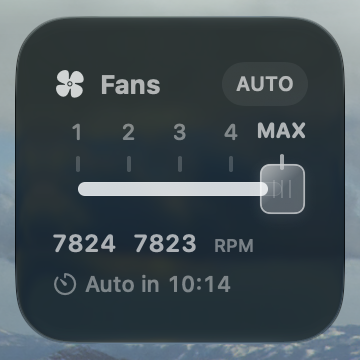
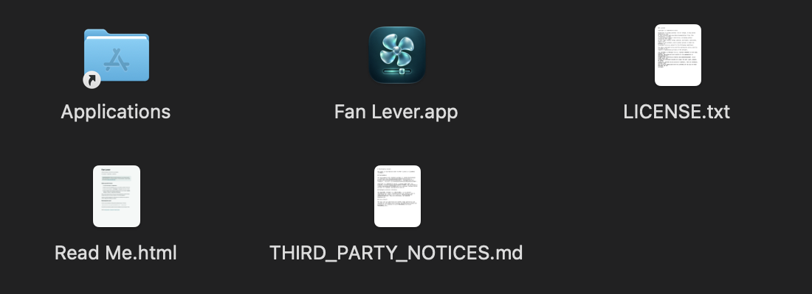

# Fan Lever

**Control your Mac’s fans from your desktop.**

A native Mac widget with a glass lever, six fan settings, and an automatic return to macOS cooling. No Dock icon. No control window. Just the lever.

[**Download for Mac →**](https://github.com/StoneHub/fan-lever/releases/tag/v0.1.0-preview.1) · [Monroe’s website](https://monroes.space) · [MIT](LICENSE)

**Apple Silicon · macOS 26+ · Tested on an M5 Pro MacBook Pro.** Other Macs are unverified and may reject fan control. The current download is a development-signed, unnotarized preview; [first-open instructions](docs/INSTALL.md#first-open).

*Actual desktop widget. Glass, tint, and accent follow your macOS settings.*

## Install

1. [Download the DMG](https://github.com/StoneHub/fan-lever/releases/download/v0.1.0-preview.1/Fan-Lever-0.1.0-preview.1-macOS-arm64.dmg), open it, and drag **Fan Lever** into **Applications**.
2. Open **Fan Lever** once. It runs without a window. If macOS blocks this preview, follow [First open](docs/INSTALL.md#first-open).
3. Control-click the desktop → **Edit Widgets** → **Fan Lever**. Add small or medium.
4. Click the widget’s setup message and approve the Fan Lever helper in **System Settings → General → Login Items & Extensions**.

## Click. Cool. Return to Auto.

| Auto | 1 | 2 | 3 | 4 | Max |
| --- | --- | --- | --- | --- | --- |
| macOS control | 40% | 55% | 70% | 85% | 100% |

Manual targets stay within each fan’s reported limits. A boost lasts **5 minutes on battery** or **30 minutes plugged in**, then returns to Auto. Click the **Auto in** countdown to cycle its duration, or click **Auto** to hand control back immediately.

RPM readings are sampled, so they can lag behind a click. The helper enforces the timer independently of widget refreshes and attempts Auto recovery after failures or serious thermal pressure. [How it works](ARCHITECTURE.md).

## More

- [Setup, updates & uninstall](docs/INSTALL.md)
- [Build from source](docs/BUILD.md)
- [Verification & known issues](STATUS.md) — the widget gallery may show a placeholder icon.
- [Dependency notices & artwork provenance](THIRD_PARTY_NOTICES.md)

Made by [Monroe Stone](https://monroes.space). [More projects on GitHub](https://github.com/StoneHub).
