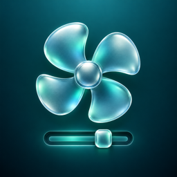

# Fan Lever



A native macOS desktop widget with a glass lever and six clickable fan settings. Apple Silicon, macOS 26 or newer. [MIT licensed](LICENSE).

Tested on an M5 Pro MacBook Pro. Other hardware is unverified; some models may reject fan control.

| Notch | Action |
| --- | --- |
| Auto | Return both fans to macOS control |
| 1 | 40% of each fan's reported maximum |
| 2 | 55% |
| 3 | 70% |
| 4 | 85% |
| Max | 100% |

Manual targets are clamped to each fan's reported minimum/maximum. Every manual selection lasts five minutes on battery or 30 minutes on AC power, then returns to Auto. Unplugging clamps an active deadline to at most five minutes remaining; reconnecting does not extend it. The helper also attempts Auto recovery after partial failure, serious/critical thermal pressure, orderly termination and crash relaunch. It does not write SMC diagnostic unlock keys. Other Mac models are unverified and may reject control.

## Use

1. Build the app using the instructions below, copy it to Applications, and open **Fan Lever** once. It runs without a window.
2. Control-click the desktop → **Edit Widgets** → **Fan Lever**, then add small or medium.
3. Click the widget’s setup message (or open `fanlever://setup`) and approve the helper in macOS **Login Items & Extensions**. This is required for privileged hardware writes.
4. Click a notch. The lever reflects confirmed controller mode/target; RPM reports measured speed, which takes time to settle. Widget telemetry is sampled and may be several minutes old; the widget labels its sample age.

The widget takes its appearance from System Settings: the system glass platter, Light or Dark mode, the glass tint, the Clear and Tinted widget styles, and your accent color, which fills the lever track up to the handle. The handle is a translucent glass gradient. `Shared/WidgetChrome.swift` holds the header, pill, surface and accent conventions; [TailOps](https://github.com/StoneHub/tailops-monitor) keeps a matching copy so the two widgets look alike side by side. Notches are App Intent buttons, not a draggable slider. The small widget has a separate Auto button and five manual notches, with two large RPM readings. Clicking the widget background refreshes its data without opening a window. The installed app has no companion window or Dock item.

To remove the service, run `'/Applications/Fan Lever.app/Contents/MacOS/Fan Lever' --disable-helper`. It confirms Auto before unregistering. Removing the app without disabling the helper first is not the supported uninstall path.

## Build

Requires Xcode 27, XcodeGen and an Apple Development signing identity for the configured team.

```sh
xcodegen generate
swift test
xcodebuild -project FanLever.xcodeproj -scheme FanLever -configuration Release \
  -derivedDataPath build/DerivedData -destination 'platform=macOS,arch=arm64' build
python3 scripts/check-app-intents.py 'build/DerivedData/Build/Products/Release/Fan Lever.app'
```

Before building with your own signing identity, update these together:

- `DEVELOPMENT_TEAM` in `project.yml`.
- The team-prefixed app group in both `Config/*.entitlements` files and `FanConstants.group` in `Shared/Models.swift`.
- The team value in `FanConstants.signedTeam` in `Shared/Models.swift`.

Keep the app, widget and helper signed by the same team and preserve XPC peer validation. The checked-in values describe the development setup; signing keys and certificates are not included. Build products appear under `build/DerivedData/Build/Products/Release/`. This repository currently publishes source; a notarized binary release is not available.

Development builds integrate DevFeedback at the revision recorded in `Vendor/DevFeedback/PROVENANCE.md`. Release omits its UI and implementation. Run a Debug build with `--preview` to open the development-only companion preview. Feedback covers that preview; widget layouts must be checked in the actual widget host. The release contains no companion UI.

Read-only diagnostics:

```sh
'/Applications/Fan Lever.app/Contents/MacOS/Fan Lever' --probe
'/Applications/Fan Lever.app/Contents/MacOS/Fan Lever' --status
```

The signed host also supports `--select 0` through `--select 5` for explicitly authorized hardware acceptance testing. This changes real fan settings and requires the approved helper.


Layout preview (actual SwiftUI content, fixture data, solid Light and Dark backgrounds; not a screenshot of the macOS glass host):

```sh
swiftc -D WIDGET_RENDER Shared/Models.swift Shared/FanClient.swift Shared/LeverView.swift Shared/SetFanIntent.swift \
  Shared/WidgetChrome.swift Widget/FanWidget.swift scripts/render-widget.swift -o .build/render-widget
.build/render-widget .build/previews
```

Add `-AppleAccentColor 5` (purple) or another accent index after the directory to preview a different accent without changing System Settings.

When updating an installed bundle with `ditto`, touch the app and widget bundle directories before forcing LaunchServices registration; copying into an existing directory can preserve its original modification date. Check the visible gallery icon separately from icon files in the signed bundle.


## License

[MIT](LICENSE), copyright © 2026 Monroe Stone. Dependency notices and icon provenance are listed in [THIRD_PARTY_NOTICES.md](THIRD_PARTY_NOTICES.md).

## Known issues

The widget gallery can retain a placeholder app icon. See [project status](STATUS.md) and [issue #1](https://github.com/StoneHub/fan-lever/issues/1).
