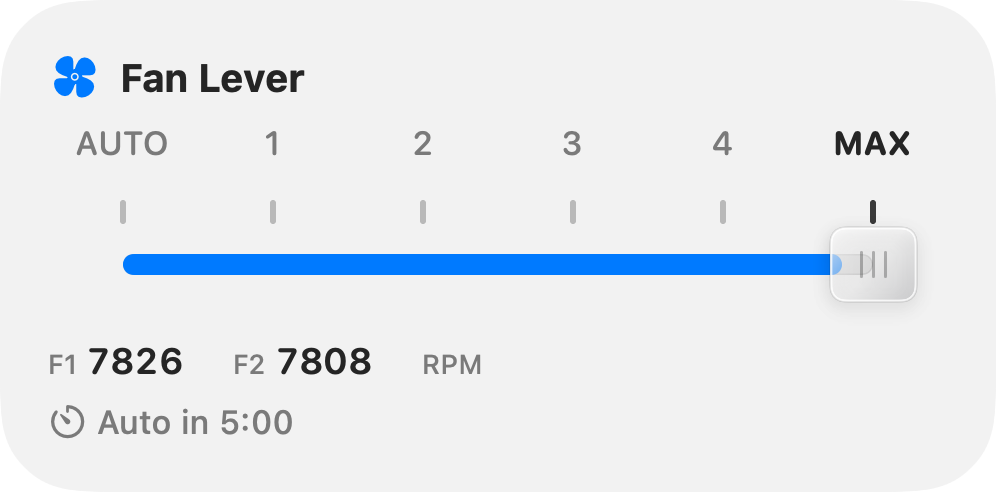
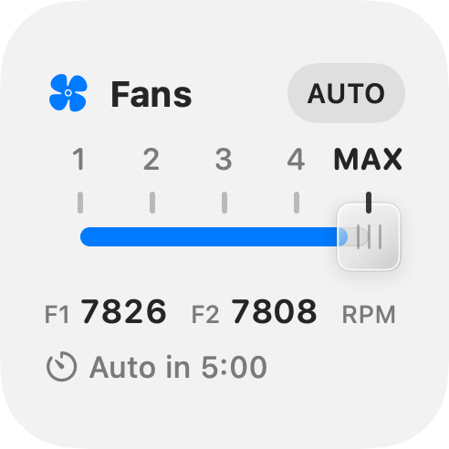
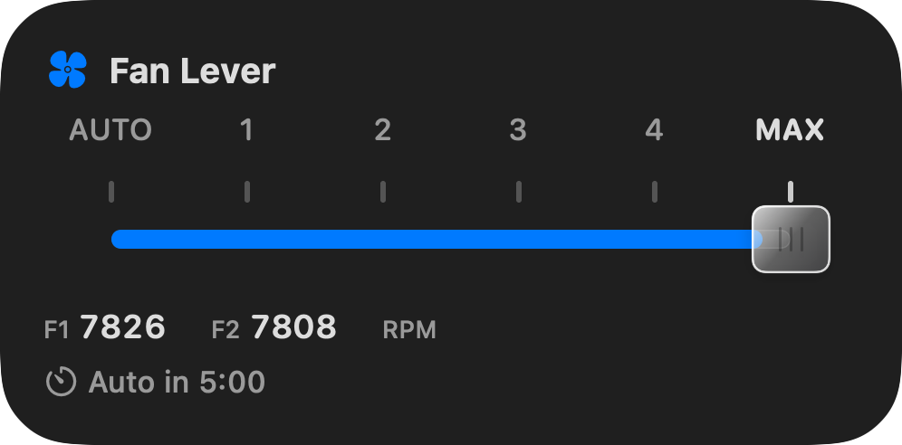
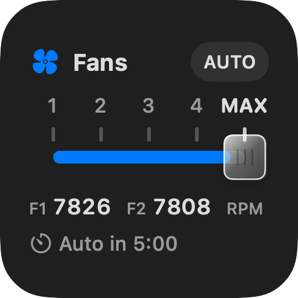

# Build Fan Lever

Requires Xcode 27, XcodeGen, and an Apple signing identity. The checked-in configuration uses Apple Development signing for team `N6GPP46885`; certificates and keys are not included.

When using another signing team, update these together:

- `DEVELOPMENT_TEAM` in `project.yml`.
- The team-prefixed app group in `Config/App.entitlements`, `Config/Widget.entitlements`, and `FanConstants.group` in `Shared/Models.swift`.
- The team requirement in `FanConstants.signedTeam` in `Shared/Models.swift`.

Keep the host, widget, and helper signed by the same team. Preserve XPC peer validation.

```sh
xcodegen generate
swift test
xcodebuild -project FanLever.xcodeproj -scheme FanLever -configuration Release \
  -derivedDataPath build/DerivedData -destination 'platform=macOS,arch=arm64' build
python3 scripts/check-app-intents.py 'build/DerivedData/Build/Products/Release/Fan Lever.app'
```

Use those same `xcodebuild` arguments with `-showBuildSettings` to confirm `TARGET_BUILD_DIR` and `FULL_PRODUCT_NAME` before copying or packaging the app. The expected product for this command is `build/DerivedData/Build/Products/Release/Fan Lever.app`.

## Package a preview

```sh
scripts/package-release.sh \
  'build/DerivedData/Build/Products/Release/Fan Lever.app' \
  build/distribution 0.1.0-preview.1 --preview
```

This validates the signatures, signing-team consistency, App Intent metadata, and absence of development feedback/control-window implementation before creating a DMG, ZIP, and checksums. The DMG contains the app, an Applications shortcut, and install instructions. It does not register a helper or change hardware settings.

An unnotarized preview requires a per-app Gatekeeper exception; packaging does not make it a notarized release. For a normal public release, sign **all three targets with your own Developer ID Application identity**, notarize the package, staple the ticket, and verify Gatekeeper acceptance. [Apple’s distribution guidance](https://developer.apple.com/developer-id/) and [notarization requirements](https://developer.apple.com/documentation/security/notarizing-macos-software-before-distribution).

## Development preview

Debug builds include DevFeedback at the revision in [PROVENANCE.md](../Vendor/DevFeedback/PROVENANCE.md). Launch a Debug build with `--preview` to open the development-only companion window. Release excludes that window and the feedback implementation; harmless no-op package APIs can remain linked.

Render the actual SwiftUI widget content with sample readings:

```sh
swiftc -D WIDGET_RENDER Shared/Models.swift Shared/FanClient.swift Shared/LeverView.swift \
  Shared/SetFanIntent.swift Shared/WidgetChrome.swift Widget/FanWidget.swift \
  scripts/render-widget.swift -o .build/render-widget
.build/render-widget .build/previews
```

Add `-AppleAccentColor 5` after the directory to preview purple without changing System Settings. These renders use solid Light/Dark backgrounds; check glass appearance and interactions in the actual desktop widget host.

 

 

*SwiftUI layout previews with sample readings; the README shows the actual desktop host.*

## Diagnostics

Read-only:

```sh
'/Applications/Fan Lever.app/Contents/MacOS/Fan Lever' --probe
'/Applications/Fan Lever.app/Contents/MacOS/Fan Lever' --status
```

`--select 0` through `--select 5` change real fan settings and require the approved helper. Use only for authorized hardware testing.

When updating an installed bundle with `ditto`, touch the app and widget bundle directories before forcing LaunchServices registration: copying into an existing directory can preserve its modification date. Check the visible gallery icon separately from the bundle’s icon assets.
